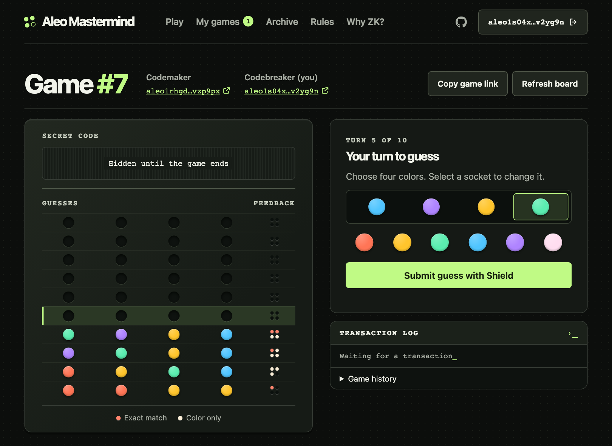

# Aleo Mastermind

A two player implementation of the classic game Mastermind on the [Aleo blockchain](https://aleo.org/). One player (codemaker) chooses a secret code with four colored pegs. The other player (codebreaker) has to guess the right combination within a ten round turn limit based on the codemaker's feedback.

This is an example of how to leverage the zero knowledge features from Aleo and can be used to learn how Aleo programs work and what applications can be built with it. While the unit tests and UI were vibed, the Leo contract code was intentionally written without AI just for the love of classical coding so there are for sure still some improvements that can be made.

## How to play

This game is intended for two players, so you can play against a friend or a random person (even against yourself if you choose the code randomly and create two accounts).

1. Install the [Shield Wallet browser extension](https://www.shield.app/).
2. Create an account in Shield and select Aleo Testnet.
3. Open the [Aleo testnet faucet](https://faucet.aleo.org/), connect Shield, and request credits. Both players use credits to submit moves.
4. Visit https://zkmastermind.troykessler.xyz/ and start playing!



## Why zero knowledge?

Programmable blockchains establish trust between two parties without needing a central authority, but this game requires keeping information (the secret code which needs to be guessed) hidden from the other player. Standard public blockchains establish trust but fail to keep anything private because they rely on having _everything_ public so validators can verify all state changes.

This is where Aleo and its zero knowledge features come in very handy since it allows for accounts to manage private state on-chain and lets us programmatically create any zkSnark proofs around that private information without needing to reveal it.

So this game is a good example of how to leverage Aleo's zero knowledge features since the codebreaker doesn't need to worry about a lying codemaker. The codemaker can derive the exact and partial match feedback from his secret code and submit it on-chain along with a zkSnark proof. Aleo validators can then verify that the codemaker indeed derived the feedback correctly without needing to know the full private information. This solves the trust and private information problem allowing for a fully decentralized version of this game.

Another good example would be Battleship, where you have to tell the other player if they hit one of your ships without giving away where all your ships are.

## Game rules

The codemaker picks four pegs from six colors and hides them in a particular order. Colors can repeat. The codebreaker gets ten guesses to find the code.

After each guess, the codemaker gives feedback. A coral clue means one peg has the right color in the right spot. An ivory clue means one peg has the right color in a different spot. The clues can come from anywhere in the row, so you still have to figure out which pegs earned them. Each peg counts once, with exact matches counted first.

Four exact matches win the game for the codebreaker, even on the last guess. If the code is still a mystery after ten guesses, the codemaker wins. Either way, the board reveals the code at the end.

## Build and test the contract

Install Leo 4.4.6 with Cargo (part of the Rust toolchain).

```sh
cargo install leo-lang --version 4.4.6 --locked
leo --version
```

From the repository root, build the contract and run its Leo tests.

```sh
leo build --path contracts --network testnet
leo test --path contracts --network testnet
```

To play through full games on a temporary local node, run the integration tests with Python 3 and npm.

```sh
python3 contracts/tests/test_devnode.py
```

## Run the frontend

With Node.js 24 installed, run these commands from the repository root.

```sh
npm --prefix frontend ci
npm --prefix frontend run dev
```

Open the local URL printed by Vite and connect Shield Wallet to play on testnet.
